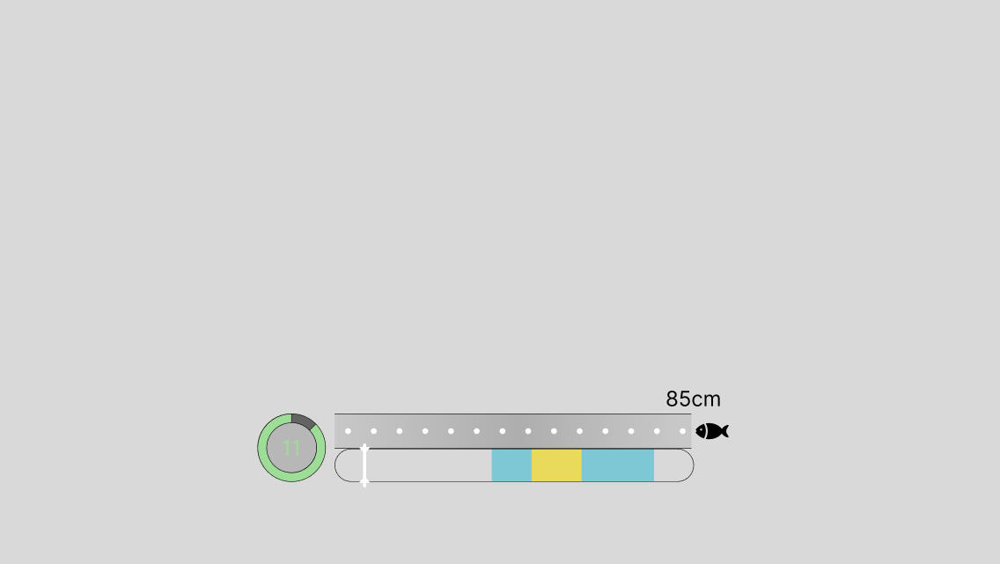

# Feedback bản thử gameplay câu cá

Bản thử: commit `5a76e0b` trên `main` (SPEC_CHUNG v0.10, luật vé GD 2026-11-10).

Cách ghi: mỗi feedback một dòng. Ghi chỗ gặp (Coral Cove hay fishing.html), việc đang làm, điều thấy được và điều muốn có. Chỉ sửa code khi người dùng bảo.

Mức độ: **Cao** (chặn chơi, sai luật), **Vừa** (khó chịu, lệch GD), **Thấp** (giao diện, câu chữ).

## Vé và ghế

| # | Chỗ gặp | Hiện tại | Mong muốn | Mức độ | Trạng thái |
| --- | --- | --- | --- | --- | --- |
| 2 | Popup mua vé câu cá | Hộp thoại kit chung: đơn giá, nút −/+ theo phút, tổng Gold, nút Đóng và Thanh toán | Dựng lại theo hình mẫu bằng ảnh trong `client-v0/public/mini game` (Art Ticket, Slider, Amount Bar, Coin Small, Button Close) | | Đã sửa 2026-11-11 (`TicketDialog.ts`, `SeatUi.ts`, `lake.css`): tiêu đề, mô tả, ảnh vé nghiêng (xoá chữ "10 phút" vẽ sẵn), số lượng + xu + tổng giá, thanh kéo, nút −/+, MIN/-10/+10/MAX, "Hiệu lực: N phút", nút Mua, nút X (Esc cũng đóng). Giá, số phút lấy từ `ticketPricing` của Server; tối đa vẫn 6 lượt (60 phút) theo `MAX_UI_DURATION_UNITS`. Mua lỗi (thiếu Gold) thì báo lỗi và giữ popup. Đã thử trên fishing.html (mock): mua 1 vé trừ 50 Gold, có vé 10 phút; test Client (191) và build đạt. Coral Cove chưa thử trình duyệt |
| 1 | Đến gần ghế, muốn vào câu | Nhấn **E** cạnh ghế trống để ngồi (theo GAMEPLAY_SCOPE GD 2026-11-10) | Khi đã hiện icon chọn ghế thì ấn **F** hoặc click vào icon để ngồi. Khác luật đã chốt "nhấn E", cần cập nhật GAMEPLAY_SCOPE/SPEC khi sửa | | Đã sửa 2026-11-11: F hoặc bấm icon Sit/số ghế để ngồi (`world.js`, `LakeScene.ts`); đã thử F trên fishing.html (mock). Coral Cove chưa thử trình duyệt (cần đăng nhập Google). GAMEPLAY_SCOPE, SPEC 0.11 đã cập nhật |

## Câu cá và minigame

| # | Chỗ gặp | Hiện tại | Mong muốn | Mức độ | Trạng thái |
| --- | --- | --- | --- | --- | --- |
| 1 | Cá cắn câu, icon móc câu để thu cần | Nút móc câu 96 px ở góc phải dưới màn hình, chỉ bấm chuột/chạm vào nút (theo GAMEPLAY_SCOPE GD 2026-11-10) | Icon to hơn, đặt gần giữa màn hình; thu cần bằng phím **Space** hoặc click vào icon. Khác luật đã chốt "nút ở góc phải", cần cập nhật GAMEPLAY_SCOPE/SPEC khi sửa | | Đã sửa 2026-11-11: nút tròn 136 px gần giữa màn hình (ngay dưới nhân vật), có chữ SPACE; Space hoặc bấm nút để thu cần (`FishButton.ts`). Đã thử trên fishing.html (mock) |
| 2 | Bấm thu cần, vào minigame | Minigame hiện ngay khi Server trả kết quả thu cần (`startMinigame` trong `FishingFlow.ts`), không có khoảng chờ | Chờ 2 giây rồi minigame mới xuất hiện. Hạn minigame do Server tính từ lúc thu cần, nên khi sửa phải để Server cộng thêm 2 giây (hoặc tính hạn từ lúc minigame hiện), tránh mất 2 giây chơi | | Đã sửa 2026-11-11: config mới `minigame.introMs` = 2000; Server tính `startedAt = lúc thu cần + 2 giây`, hạn lùi theo (migration `BEE_MinigameIntro`); Client chờ 2 giây theo giờ thật rồi mới hiện. Đã thử trên fishing.html: minigame hiện sau ~2,04 giây; test Server và Client đạt |
| 3 | Giao diện minigame | Khung 400x96 ở phần trên màn hình: chữ "Khoảng cách tới cá" + thanh HP mỏng, số giây dạng chữ, thanh đo thẳng có vùng xanh/vàng và kim, dòng hướng dẫn ở dưới (`MinigameScene.ts`) | Dựng lại theo ảnh mẫu [feedback/minigame-ui.png](feedback/minigame-ui.png), xem chi tiết ở mục "Ảnh mẫu minigame" bên dưới | | Đã sửa 2026-11-11 (`MinigameScene.ts`): đồng hồ tròn, thanh khoảng cách có chấm trắng + con cá + số cm còn lại (= HP, cá tiến lại gần khi trúng), thanh đo bo tròn có kim hai đầu nhọn. Đã chụp trên fishing.html (mock); chờ người dùng xem lại |
| 4 | Bấm thu cần, chờ minigame sau lần sửa #2 | Minigame hiện sau 2 giây (`minigame.introMs` = 2000) | Đổi khoảng chờ thành 0,75 giây (`introMs` = 750); Server, fixture và migration config đã lưu cũng phải đổi theo | | Đã sửa 2026-11-11: `minigame.introMs` = 750 ở fixture, migration `BEE_MinigameIntro` và mặc định Client. Đã thử trên fishing.html (mock): minigame hiện sau ~0,79 giây; test Server (Domain 156, Api 196) và Client (190) đạt |
| 5 | Kim trắng trong minigame | `needlePassMs` theo độ hiếm: 900 / 800 / 700 / 600 / 550 ms | Giảm 20% (kim nhanh hơn) | | Đã sửa 2026-11-11: 720 / 640 / 560 / 480 / 440 ms trong `gameplay-config.v0.json` và mẫu `minigame-vectors.v0.json`, bảng độ khó trong GAMEPLAY_SCOPE. Test Server (Domain 156, Api 196) và Client (190) đạt. Server thật đã có config trong DB thì cần publish bản mới qua Admin mới có hiệu lực |
| 6 | Cá cắn câu: nút kéo và dấu ! | Nút móc câu nhấp nhẹ (phóng 6%, 0,6 giây/nhịp); dấu ! đứng yên | Nút kéo nhấp mạnh và dày hơn; dấu ! lắc trái phải | | Đã sửa 2026-11-11: nút phóng tới 125%, 0,36 giây/nhịp (`fishing.css`); dấu ! lắc ±3 px ở fishing.html (`CharacterView.ts`) và Coral Cove (`player.js`). Đã thử trên fishing.html (mock): dấu ! dịch -2,8..3 px, nút chạy hiệu ứng mới. Coral Cove chưa thử trình duyệt |
| 7 | Giao diện minigame sau lần sửa #3 | Vẽ bằng hình khối đơn giản (vòng tròn, thanh xám, cá đen) | Dựng lại theo hình mẫu bằng ảnh nguồn trong `client-v0/public/mini game` (Timer, Fish Path, Hit Bar, Needle, Fish Marker) | | Đã sửa 2026-11-11 (`MinigameScene.ts`): dùng đúng 5 ảnh nguồn; vùng xanh/vàng, số chấm, vị trí cá và cung xám đồng hồ vẽ lại theo trạng thái; số giây vẽ dạng pixel. Đã chụp trên fishing.html (mock); test Client (190) và build đạt. Coral Cove chưa thử trình duyệt |
| 8 | Nút móc câu khi cá cắn | Nút tròn đỏ viền kem, icon móc câu vẽ bằng SVG | Thay bằng ảnh `client-v0/public/mini game/Button Hook.png` | | Đã sửa 2026-11-11 (`FishButton.ts`, `fishing.css`): hình nút là ảnh Button Hook (139x144 px), vẫn giữ chữ SPACE và thanh đếm ngược bên dưới, hiệu ứng nhấp giữ nguyên. Đã chụp trên fishing.html (mock); test Client (190) đạt. Coral Cove chưa thử trình duyệt |

| 9 | Ngồi ghế câu ở Coral Cove | Khi câu, nhân vật giữ tư thế ngồi, cần đặt trên đùi (`SIT_HAND` trong `player.js`): cần lệch chỗ, không có động tác quăng/kéo cần | Cần nằm đúng trong tay, nhân vật diễn động tác câu | | Đã sửa 2026-11-11 (`player.js`): khi câu dù đang ngồi ghế vẫn dùng bộ hình câu cá (quăng cần, chờ phao, kéo cần) và vị trí tay của bộ hình đó; bỏ `SIT_HAND`. Đã xem trên trang thử tạm (đã xoá) cho 4 hướng; test `npm test` (32) và vitest (191) đạt. Coral Cove chưa thử trình duyệt |

## Kết quả, túi đồ, shop

| # | Chỗ gặp | Hiện tại | Mong muốn | Mức độ | Trạng thái |
| --- | --- | --- | --- | --- | --- |
| 1 | Popup nhận cá khi câu được | Popup chỉ có ô vuông màu theo độ hiếm thay cho hình cá (`openPopup` trong `FishingFlow.ts`); hình cá chỉ xuất hiện sau khi bấm nhận/đóng popup | Hình (icon) con cá phải hiện ngay trong popup nhận cá, không đợi bấm nhận rồi mới xuất hiện | | Đã sửa 2026-11-11: popup hiện hình cá pixel ngay khi mở (Coral Cove dùng màu từng loài, fishing.html dùng màu độ hiếm). Hình cá vẫn là art tạm. Đã thử trên fishing.html (mock) |
| 2 | Câu được cá trong Coral Cove | Hình cá to hiện trên đầu nhân vật của mình sau khi câu được (`showCatch` gọi từ `CoralCoveOnline.ts`) | Tắt hình cá trên đầu nhân vật | | Đã sửa 2026-11-11: bỏ lời gọi `showCatch` khi câu được; hình cá chỉ còn trong popup. Phần người chơi khác thấy cá trên đầu mình (`CatchShown`, theo GD) vẫn giữ ở fishing.html. Chưa thử trình duyệt Coral Cove |
| 3 | Popup nhận cá sau lần sửa #1 | Bảng tối "Câu được cá!": hình cá, tên, độ hiếm, cm, Mới/Kỷ lục, EXP, "Chạm để câu tiếp" | Thay bằng thẻ theo ảnh `client-v0/public/mini game/Catch Fish.png`; thông tin động lấy theo Server gửi về | | Đã sửa 2026-11-11 (`CatchCard.ts`, `FishingFlow.ts`, `fishing.css`): xoá cá và chữ mẫu trong ảnh, điền Tên, Độ hiếm (màu theo độ hiếm), Nơi sống (Coral Cove; fishing.html hiện mapId), Kích thước, Giá (`sellGold` của loài trong catalog), chữ đỏ "Kỷ lục mới"/"Loài mới"; dòng "Chạm ra ngoài để đóng", chạm vào thẻ không đóng. Thẻ không còn EXP và "Lên cấp". Đã chụp trên fishing.html (mock); test Client (191) đạt. Coral Cove chưa thử trình duyệt |

| 4 | Chữ trên thẻ nhận cá | Nhãn cột trái (Tên, Độ hiếm, Nơi sống, Kích thước, Giá) là chữ vẽ sẵn trong ảnh, bị méo khi thẻ thu phóng; khác phông với giá trị | Xoá chữ có sẵn trong ảnh, thay bằng chữ của code | | Đã sửa 2026-11-12 (`CatchCard.ts`): xoá toàn bộ chữ trong 5 hàng của ảnh (giữ đồng xu và đường kẻ), nhãn viết bằng code cùng phông với giá trị. Đã chụp trên fishing.html (mock); test Client (191) đạt. Coral Cove chưa thử trình duyệt |

## Giao diện, âm thanh, hình ảnh

| # | Chỗ gặp | Hiện tại | Mong muốn | Mức độ | Trạng thái |
| --- | --- | --- | --- | --- | --- |
| 1 | Camera khi đi lại trên map | Camera bám theo nhân vật, zoom vừa khung 1024x716 theo cửa sổ (`cameraZoom` trong `world.js`) | Đẩy camera xuống (zoom xa hơn) để nhìn thấy màn chơi rộng hơn. Cần chốt mức zoom khi sửa | | Đã sửa 2026-11-11: Coral Cove thấy rộng hơn 25% (khoảng 1280x895, `ROOM_VIEW_SCALE` trong `world.js`) theo lựa chọn của người dùng. Chưa thử trình duyệt (cần đăng nhập Google) |
| 2 | Camera Coral Cove sau lần sửa #1 | Coral Cove thấy rộng hơn khung chuẩn 25% (khoảng 1280x895) | Zoom gần camera lại 50%: người dùng chốt 2026-11-11 là phóng to 50% so với hiện tại, tức thấy khoảng 853x597 (nhỏ hơn khung chuẩn 1024x716) | | Đã sửa 2026-11-11: `ROOM_VIEW_SCALE.coralCove` = 1,25 / 1,5 trong `world.js`. Chưa thử trình duyệt (Coral Cove cần đăng nhập Google) |
| 3 | Camera Coral Cove sau lần sửa #2 | Thấy khoảng 853x597 | Zoom gần thêm 20% | | Đã sửa 2026-11-11: `ROOM_VIEW_SCALE.coralCove` = 1,25 / 1,5 / 1,2 ≈ 0,69, thấy khoảng 711x497 (`world.js`). Chưa thử trình duyệt (Coral Cove cần đăng nhập Google) |

## Khác

| # | Chỗ gặp | Hiện tại | Mong muốn | Mức độ | Trạng thái |
| --- | --- | --- | --- | --- | --- |
| 2 | Các UI vừa dựng (popup vé, thẻ nhận cá, nút móc câu, minigame) | Hiện/ẩn bật tắt tức thì | Có easing, fade in, fade out; **quy tắc từ nay: mọi popup/UI mới đều phải có hiệu ứng vào/ra** | | Đã sửa 2026-11-12: thêm `ui/kit/motion.ts` (`animateIn`, `animateOut`, `removeWithMotion`) và lớp `.ui-in-pop/.ui-in-fade/.ui-out-*` trong `kit.css` (vào 260 ms phóng 0,85→1 có nảy, ra 160 ms mờ và thu 0,9). Popup vé: nền tối mờ dần, khung phóng ra/thu lại. Thẻ nhận cá: phóng ra/thu lại. Nút móc câu: mờ + phóng có nảy, ẩn thì mờ + thu. Minigame: hiện dần và trồi lên 6 px, kết thúc thì mờ dần rồi mới dừng. Hiệu ứng không tắt theo cài đặt giảm chuyển động của Windows. Đã đo trên fishing.html (mock); test Client (191) và build đạt. Coral Cove chưa thử trình duyệt |
| 3 | Đăng nhập Google ở index.html | Đăng nhập xong vào Coral Cove (`START_ROOM` = `coralCove`) | Đăng nhập xong chuyển sang `/fishing.html` | | Đã sửa 2026-11-12: nút Google ở `src/main.js` mờ trang 200 ms rồi chuyển sang `/fishing.html`; trang đó dùng lại phiên Firebase nên không hỏi đăng nhập lần nữa. Build đạt. Chưa thử trình duyệt (cần đăng nhập Google). `.env.local` đang `VITE_USE_MOCK=true` nên fishing.html vẫn chạy mock, chưa gọi Server thật |
| 1 | Coral Cove (`world.js`) và fishing.html (`LakeScene.ts`) | Click chuột lên map thì nhân vật tự đi tới điểm đó | Bỏ di chuyển nhân vật bằng chuột | | Đã sửa 2026-11-11: bỏ click để đi ở cả hai nơi; bấm số ghế khi ở xa chỉ nhắc "Hãy đi tới gần ghế để ngồi". Đã thử trên fishing.html (bấm map, nhân vật đứng yên). Coral Cove chưa thử trình duyệt |

## Ảnh mẫu minigame (feedback Câu cá #3)

Mô tả theo ảnh:

- Cả cụm nằm ở nửa dưới, giữa màn hình; phần trên để trống cho thấy map.
- Bên trái: vòng tròn đếm giờ, viền xanh lá với phần xám là thời gian đã trôi, số giây còn lại ở giữa (ví dụ 11).
- Hàng trên: thanh khoảng cách màu xám có các chấm trắng, biểu tượng con cá ở đầu bên phải, số "85cm" phía trên góc phải. Người dùng chốt 2026-11-11: chấm trắng và số cm là khoảng cách còn lại tới cá (HP).
- Hàng dưới: thanh đo bo tròn hai đầu, vùng xanh dương với vùng vàng nằm trong, kim trắng dạng vạch đứng có hai đầu nhọn chạy qua lại.
- Không còn chữ "Khoảng cách tới cá" và dòng hướng dẫn như bản hiện tại.

## Ghi chú tự do

-
